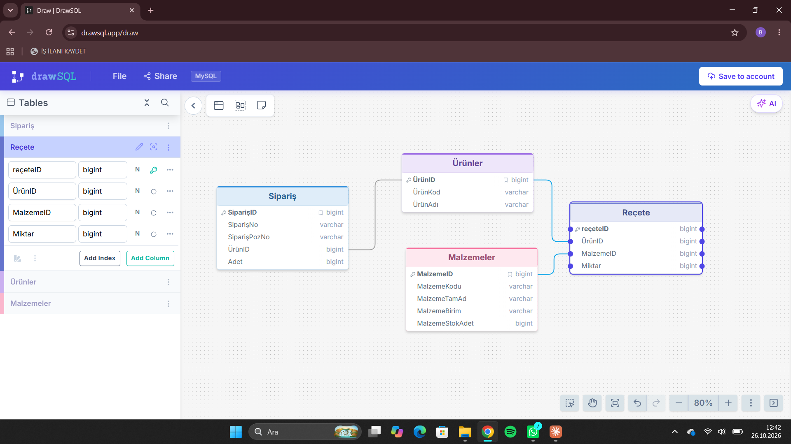

# MiniMRP

Sipariş bazlı **malzeme ihtiyaç planlama (MRP)** uygulaması. Siparişleri reçeteyle çarpar, stokla karşılaştırır ve her malzeme için **ne kadar eksik olduğunu** gösterir; birden fazla siparişin ortak malzemelerini tek satırda toplar.

ASP.NET Core MVC · EF Core · SQLite · xUnit · .NET 10

## Neden bu proje?

Üretim planlamada çalışırken her gün sorulan soru şu: *"Bu siparişi üretebilir miyiz, üretemiyorsak neyi, ne kadar eksik?"* Büyük ERP/MRP sistemlerinde stok düşümü anlık olmadığında bu sorunun cevabı Excel'de elle hesaplanıyor; birden fazla sipariş aynı malzemeyi kullandığında ise tek tek bakınca yetiyor gibi görünen stok, toplamda yetmiyor.

MiniMRP bu soruyu iki seviyede cevaplar:

- **Sipariş bazında:** Bir siparişin reçetesine göre her malzemenin ihtiyacı, stoğu ve eksiği.
- **Toplamda:** Tüm siparişlerin ihtiyacı malzeme bazında toplanır. *Her sipariş tek başına karşılanıyor ama toplamda yetmiyor* durumu burada görünür.

## Ekran görüntüleri

| Siparişler | Sipariş detayı ve malzeme ihtiyacı |
|---|---|
|  |  |
| **Yeni sipariş (doğrulama)** | **Toplam malzeme ihtiyacı** |
|  |  |

## Özellikler

- Siparişleri listeleme (sipariş no, pozisyon, ürün, adet)
- Sipariş detayında reçeteye göre malzeme ihtiyacı, stok ve eksik miktar
- Yeni sipariş girişi: form doğrulama, aynı sipariş + pozisyonda aynı ürünün iki kez girilmesini engelleme
- Tüm siparişler için malzeme bazında toplam ihtiyaç ve eksik

## Mimari

```
MiniMRP.sln
├── MiniMRP.Core    Varlıklar (Order, Product, Material, RecipeItem) ve hesaplama (MrpCalculator)
│                   Hiçbir pakete bağımlı değil: veritabanı yok, web yok.
├── MiniMRP.Web     ASP.NET Core MVC: Controller, View, ViewModel, EF Core DbContext ve migration'lar
└── MiniMRP.Tests   xUnit testleri (Core'u test eder)
```

**Neden ayrı bir Core projesi?** MRP hesabı uygulamanın asıl değeri. Hesap, veritabanından ve arayüzden bağımsız olduğu için testler veritabanı kurmadan saniyenin altında çalışır. Arayüz veya veritabanı değişse bile hesap kodu değişmez.

Diğer kararlar:

- **Ekrana özgü doğrulama kuralları ViewModel'de**, Core'daki varlıklarda değil. Core sadece iş kuralını bilir.
- **Katmanlı savunma:** "Aynı sipariş + pozisyon + ürün" kuralı hem kodda (`AnyAsync`, kullanıcıya anlaşılır mesaj) hem veritabanında (unique index, eşzamanlı isteklerde bile garanti) uygulanır.
- **Silme davranışı `Restrict`:** Siparişte veya reçetede kullanılan bir ürün/malzeme silinemez. Geçmiş kayıtlar sessizce kaybolmaz.
- **Şema migration ile yönetilir** (`EnsureCreated` değil). Her değişiklik geri alınabilir bir adım olarak repoda durur.
- **Post-Redirect-Get:** Sipariş kaydedildikten sonra listeye yönlendirilir. Sayfa yenilenince aynı sipariş ikinci kez gönderilmez.

## Nasıl çalıştırılır

Gereksinim: [.NET 10 SDK](https://dotnet.microsoft.com/download)

```bash
git clone https://github.com/BerkayP22/MiniMRP.git
cd MiniMRP
dotnet tool install --global dotnet-ef
dotnet build
dotnet ef database update --project MiniMRP.Web
dotnet run --project MiniMRP.Web
```

Tarayıcıda `http://localhost:5076/Orders` adresini açın. Veritabanı (`minimrp.db`) migration ile oluşturulur ve örnek veriyle (Masa reçetesi, 3 malzeme, 1 sipariş) gelir.

Visual Studio kullanıyorsanız `dotnet ef database update` yerine Package Manager Console'da `Update-Database` komutunu çalıştırabilirsiniz.

Testler:

```bash
dotnet test
```

## Testler ve yöntem

Her hesaplama kuralı için yöntem aynı:

1. **Elle hesap:** Beklenen sonuç kağıt üzerinde hesaplanır (aşağıdaki örnek hesap gibi).
2. **Test:** Bu sonuç teste beklenen değer olarak yazılır ve test kırmızı görülür.
3. **Kod:** Test yeşile dönene kadar kod yazılır.

Beklenen değerler koddan veya başka bir testten kopyalanmaz; her zaman elle hesaptan gelir. Testlerin gerçekten hata yakaladığı, kodu bilerek bozup testin kırmızıya dönmesiyle (mutation testing) kontrol edildi.

| Test | Neyi doğrular |
|---|---|
| `Shortage_StockNotEnough_ReturnsMissingQuantity` | Stok yetmezse eksik = ihtiyaç − stok |
| `Shortage_StockEnough_ReturnsZero` | Stok yeterse eksik 0, negatif değil |
| `Calculate_StockNotEnough_ReturnsShortagePerMaterial` | Tek sipariş, her malzemenin eksiği |
| `Calculate_StockEnough_ReturnsZeroShortage` | Tek sipariş, stok yeterli |
| `CalculateTotal_MaterialRequirementsFromMultipleOrders_ReturnsTotalShortagePerMaterial` | Birden fazla siparişte ortak malzeme tek satırda toplanır |
| `CalculateTotal_EachOrderFitsButTotalDoesNot_ReturnsShortage` | Her sipariş tek başına yetiyor, toplamda yetmiyor |

## Örnek hesap

Örnek veride **SIP-001 / poz 10: 15 adet Masa** siparişi var. Masa reçetesi: 1 tabla, 4 ayaklık, 10 vida.

| Malzeme | İhtiyaç | Stok | Eksik |
|---|---|---|---|
| Tabla | 1 × 15 = 15 | 10 | 5 |
| Ayaklık | 4 × 15 = 60 | 50 | 10 |
| Vida | 10 × 15 = 150 | 100 | 50 |

Sonuç: Sipariş bu stokla üretilemez; her malzemenin eksik miktarı ekranda gösterilir.

## Veri modeli



| Tablo | Alanlar | Not |
|---|---|---|
| Orders | Id, No, PositionNo, ProductId, Quantity | (No, PositionNo, ProductId) benzersiz |
| Products | Id, Code, Name | Code benzersiz |
| Materials | Id, Code, FullName, Unit, StockQuantity | Code benzersiz |
| RecipeItems | Id, ProductId, MaterialId, Quantity | (ProductId, MaterialId) benzersiz |

Tasarım kararları:

- **Reçete ayrı tablo:** Bir ürün çok malzeme, bir malzeme çok üründe kullanılır (N-N). "Kaç adet" bilgisi ne ürüne ne malzemeye, ikisinin arasındaki bağa aittir.
- **İlişkiler ID ile kurulur, kodla değil:** Malzeme kodu değişse bile reçete ve siparişler etkilenmez.
- **Sipariş + pozisyon + ürün:** Gerçek iş kuralına göre aynı sipariş pozisyonunda farklı ürünler olabilir, aynı ürün iki kez olamaz.
- **Miktarlar tam sayı (`long`):** Şu an tüm malzemeler adet bazlı. Kesirli birimler (kg, metre) gerekirse `decimal`'e geçilecek.

## Bilinen kısıtlar ve sonraki adımlar

- **Stok siparişlere önceliğe göre dağıtılmıyor.** Toplam ihtiyaç doğru, ama hangi siparişin önce karşılanacağı hesaplanmıyor. Gerçekte öncelik teslim/üretim tarihi, aciliyet ve gecikmeye göre belirlenir. Bir sonraki büyük adım bu.
- Tek seviyeli ürün ağacı (yarı mamul içinde yarı mamul yok)
- Ürün, malzeme ve reçete için ekleme/düzenleme ekranları yok (örnek veriyle gelir)
- Üretim sonrası stoktan düşme ve sipariş durumu (bekliyor / üretildi) yok
- Kullanıcı girişi ve yetkilendirme yok
- Yayına alma (deploy) planlanıyor
