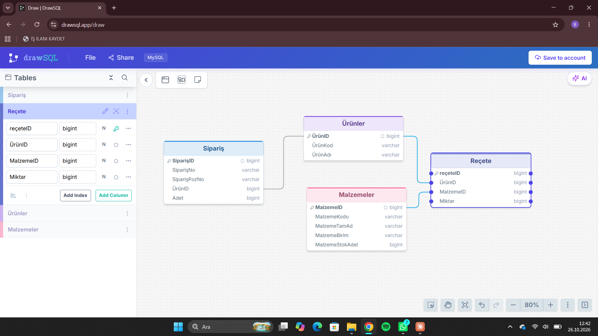

# MiniMRP

Sipariş bazlı malzeme ihtiyaç planlama (MRP) uygulaması. Bir siparişin üretimi için gereken malzemeleri hesaplar, stokla karşılaştırır ve eksikleri gösterir.

> Durum: tasarım aşaması (veri modeli hazır, kodlama başlıyor).

## Problem

Şirketlerde bulunan MRP'de anlık düşüm olmaması sonucu yaşanan sıkıntılar ele alındı,bu yönde basit bir database diyagramı temel şablon olarak çıkartıldı,asıl amaç bu programın temelden başlayarak günden güne büyümesi. Yani ana amaç şuanda bir siparişin üretilmesi için gerekli malzemenin olup olmadığı.

## Kapsam

Kullanıcı bu uygulama genelinde ilk etapta siparişleri listeleyebilecek,bu siparişlerin üretim ağacını görebilecek, siparişin eksik malzemelerini ve normal malzemeleri anlık olarak kontrol edebilecek.

### MVP'de var
- Siparişleri listeleme
- Bir siparişin üretim ağacını (reçetesini) görme
- Siparişin malzeme ihtiyacını ve eksik malzemeleri anlık kontrol etme

### MVP'de yok (sonraki sürümler)
- Stoktan düşme (üretim sonrası stok güncelleme)
- Sipariş durumu (bekliyor / üretildi)
- Kullanıcı girişi ve yetkilendirme
- Çok seviyeli ürün ağacı (yarı mamul içinde yarı mamul)

### Veri girişi
- İlk sürümde ürün, malzeme ve reçete verileri örnek (açılış) verisi olarak hazır yüklenir; ekleme/düzenleme ekranları sonraki adımda gelir. *(varsayım — değiştirmek istersen bu satırı güncelle)*

## Veri modeli

Siparişler tablosu;
-Siparişlerin bulunduğu, içinde ürün numarası pozisyon numarası ürünID ve adet bulunduran tablo. Kullanıcı tüm sipariş detaylarını bu tablodan çekilen verilerle görecek. Siparişlerin kaydının tutulması ve bilgilerine ulaşılabilmesi adına bu tablo mevcut.

Ürünler Tablosu;
-Ürünler ile ilgili bilgilerin bulunduğu, ürün kodunu ürün adını ve primary olarak ÜrünID belirten tablo. Bu tabloda üretimde üretilen ürünlerin kodları,isimleri mevcut. Burada Ürünlerin genel bilgisini bulabiliriz.

Malzemeler Tablosu;
-Ürünler tablosu ile aynı mantıkta çalışan, malzemelerin bilgilerinin bulunduğu stokta olan malzemelerin adetini ve bilgisini veren tablo. Ürün üretmekte kullanılan malzemeler burada tutulur.

Reçete;
-Bir ürünün hangi malzemeden kaç adet kullandığının tanımlandığı tablo (ürün ağacı). Sipariş bu reçeteyi kullanır: sipariş adedi × reçete miktarı = ihtiyaç.
-Tablonun olma sebebi bir ürünün hangi malzemeleri ne kadar birim ile kullanacağını öngörmek. Eksik malzeme varsa bunun tedariğini sağlayabilmek

### Tablolar ve alanlar

| Tablo | Alan | Tip | Anahtar |
|---|---|---|---|
| Sipariş | SiparişID | bigint | PK |
| | SiparişNo | varchar | |
| | SiparişPozNo | varchar | |
| | ÜrünID | bigint | FK → Ürünler.ÜrünID |
| | Adet | bigint | |
| Ürünler | ÜrünID | bigint | PK |
| | ÜrünKod | varchar | |
| | ÜrünAdı | varchar | |
| Malzemeler | MalzemeID | bigint | PK |
| | MalzemeKodu | varchar | |
| | MalzemeTamAd | varchar | |
| | MalzemeBirim | varchar | |
| | MalzemeStokAdet | bigint | |
| Reçete | reçeteID | bigint | PK |
| | ÜrünID | bigint | FK → Ürünler.ÜrünID |
| | MalzemeID | bigint | FK → Malzemeler.MalzemeID |
| | Miktar | bigint | |

### Kararlar ve gerekçeleri
- **Malzemeler satır olarak tutulur:** yeni malzeme = yeni satır; tablonun yapısı değişmez.
- **Reçete ayrı tablo:** bir ürün çok malzeme, bir malzeme çok üründe kullanılır (N-N). "Kaç adet" bilgisi ürüne de malzemeye de değil, ikisinin arasındaki bağa aittir.
- **Reçete'nin kendi kimliği (reçeteID):** bir ürünün reçetede birden çok satırı olduğu için ÜrünID tek başına birincil anahtar olamaz.
- **İlişkiler ID ile kurulur, kodla değil:** kod değişse bile reçete ve siparişler etkilenmez; tipler (bigint) uyumludur.
- **Miktar ve stok bigint:** MVP'de tüm malzemeler adet bazlıdır. Kesirli miktar (kg, metre) gerekirse decimal'e geçilecek.
- **SiparişNo + SiparişPozNo:** bir siparişte birden fazla ürün olabilir; her pozisyon ayrı satırdır.

## Örnek hesap

Örnek olarak 15 adet masa siparişi verildi;

Masa için gerekli malzemeler;
-1 ADET TABLA
-4 AYAKLIK
-10 TANE VİDA

Hesaplama için;
-Reçeteden yukarıdaki bilgiler çıkartılır, istenilen adet sayısı ile çarpılır.
İHTİYAÇ;
-1X15
-4X15
-10X15

Stok malzemelerden düşülür,

-Stokta 100 adet tabla var,
-Stokta 100 adet ayaklık var,
-Stokta 1000 adet vida var,

Sipariş üretildikten sonra kalan sayıları;

| Malzeme | İhtiyaç | Stok | Kalan |
|---|---|---|---|
| Tabla | 1 × 15 = 15 | 100 | 85 |
| Ayaklık | 4 × 15 = 60 | 100 | 40 |
| Vida | 10 × 15 = 150 | 1000 | 850 |

Bu ürün üretilebilir.

Olumsuz durumda ise;
İHTİYAÇ;
-1X15
-4X15
-10X15

Stokta malzeme;
Tabla 10 adet
ayaklık 50 adet
vida 100 adet

| Malzeme | İhtiyaç | Stok | Eksik |
|---|---|---|---|
| Tabla | 15 | 10 | 5 |
| Ayaklık | 60 | 50 | 10 |
| Vida | 150 | 100 | 50 |

Bu ürün üretilemez. Üretilemediği kullanıcıya gerek renklerle, gerek başka yöntemlerle belli edilir; her malzeme için eksik miktar gösterilir.

Bu sipariş üretilemez.
